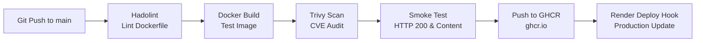

# DevOps Portfolio & Resume (CI/CD)

[](https://github.com/dimakozlov538-cpu/portfolio_DevOps)
[](https://github.com/dimakozlov538-cpu/portfolio_DevOps/actions/workflows/ci-cd.yml)


Веб-приложение с резюме DevOps-инженера, упакованное в защищенный Docker-контейнер с настроенным автоматическим **CI/CD** конвейером.

**Live Demo:** [https://portfolio-devops-zex1.onrender.com/](https://portfolio-devops-zex1.onrender.com/)

---

Архитектура CI/CD пайплайна

При каждом пуше в ветку `main` автоматически запускается конвейер в **GitHub Actions**, который проверяет качество кода, сканирует образ на уязвимости, проводит Smoke-тестирование и обновляет продакшен на **Render** без простоев:



Реализованные DevOps практики

* **Безопасность контейнера (Container Hardening):**
  * Используется непривилегированный базовый образ `nginxinc/nginx-unprivileged:alpine` (процессы работают от пользователя `nginx` с UID `101`, без прав `root`).
  * При сборке выполняется `apk upgrade --no-cache` для закрытия актуальных уязвимостей в системных пакетах Alpine Linux.
  * Настроен встроенный `HEALTHCHECK` для контроля состояния веб-сервера.
* **DevSecOps в CI/CD:**
  * **Hadolint** проверяет `Dockerfile` на соответствие best practices.
  * **Trivy** блокирует сборку (`exit-code: 1`), если в образе обнаружены критические уязвимости (`CRITICAL` CVE).
  * **Smoke Test** поднимает временный контейнер и проверяет через `curl` и `grep`, что приложение отдает код `200 OK` и корректный контент.
* **Production-конфигурация Nginx (`nginx.conf`):**
  * Включено сжатие трафика (`gzip`) для ускорения загрузки HTML и CSS.
  * Настроены заголовки кэширования (`Cache-Control` на 7 дней для статики и `no-cache` для главной страницы).
  * Добавлены заголовки безопасности (`X-Frame-Options`, `X-Content-Type-Options`) и скрыта версия сервера (`server_tokens off`).

---

Локальный запуск (через Makefile)

Для удобного управления контейнером локально используется `Makefile`:

```bash
# Собрать Docker-образ локально
make build

# Запустить контейнер в фоне (будет доступен на http://localhost:8080)
make run

# Проверить статус контейнера и HEALTHCHECK
make status

# Посмотреть логи Nginx в реальном времени
make logs

# Пересобрать образ и перезапустить контейнер после правок
make restart

# Остановить контейнер и удалить локальный образ
make clean
```

---

 Структура проекта

```text
.
├── .github/workflows/
│   └── ci-cd.yml          # Конфигурация CI/CD и DevSecOps пайплайна
├── static/
│   ├── img/photo.jpg      # Аватар профиля
│   └── style.css          # Стили резюме
├── templates/
│   └── index.html         # HTML-шаблон резюме
├── Dockerfile             # Production Dockerfile (unprivileged + apk upgrade)
├── Makefile               # Автоматизация локальной сборки и запуска
├── nginx.conf             # Кастомный конфиг Nginx (gzip, cache, security headers)
└── README.md              # Документация проекта
```

